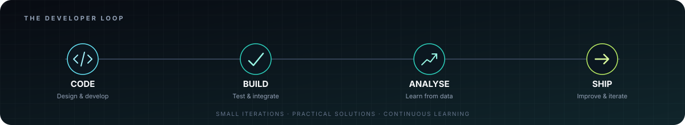

<!-- Personal profile README — Aman Jain | motion-led portfolio -->

 

  
  
  

---

## Technology, data & business — connected

I'm a **Full Stack Developer and Consultant & Data Analyst** with **6+ years of experience** across software development, data analysis, business analysis, and management consulting.

I enjoy moving between understanding a problem, exploring the evidence, and building a useful solution. My approach combines **engineering thinking, analytical rigour, and practical business outcomes**.

- **Current role:** Senior Associate — Consultant & Data Analyst at **Nangia & Co. LLP**.
- **Consulting:** Supporting Railway Board initiatives through TT&BRU, including business research, commercial studies, stakeholder consultations, field surveys, reports, and digital transformation.
- **Development:** Responsive web applications, APIs, database-backed platforms, and productivity tools.
- 📍 **Location:** New Delhi, India.
- 💼 **Portfolio:** [Visit my Portfolio](https://amanjaina.github.io/Portfolio/)

  

## What I bring to a project

<table>
  <tr>
    <td width="33%" valign="top">
      <h3>01 / Build</h3>
      Create responsive, maintainable digital products with practical interfaces, integrations, and reliable data flows.
        FULL STACK · APIS · DATABASES
    </td>
    <td width="33%" valign="top">
      <h3>02 / Analyse</h3>
      Turn information and research into structured findings, clear reports, and decision-ready insights.
        DATA · BUSINESS ANALYSIS · RESEARCH
    </td>
    <td width="33%" valign="top">
      <h3>03 / Improve</h3>
      Connect user and operational needs with business opportunities and implementable recommendations.
        CONSULTING · STRATEGY · DIGITAL CHANGE
    </td>
  </tr>
</table>

## Selected projects

<table>
  <tr>
    <td width="50%" valign="top">
      <h3>🏡 <a href="https://github.com/AmanJainA/LifeHub">LifeHub</a></h3>
      PRODUCTIVITY · WEB APP
      
A personal productivity and life-management application focused on keeping everyday information and workflows organised.

      
    </td>
    <td width="50%" valign="top">
      <h3>🚆 <a href="https://github.com/AmanJainA/Railways">Railways</a></h3>
      RAILWAY · PORTAL
      
A railway-focused web portal project bringing structured information and digital workflows into one place.

      
    </td>
  </tr>
  <tr>
    <td width="50%" valign="top">
      <h3>🧠 <a href="https://github.com/AmanJainA/Interview">Interview</a></h3>
      LEARNING · ASSESSMENT
      
An interview-preparation and MCQ practice application with assessment-oriented features.

      
    </td>
    <td width="50%" valign="top">
      <h3>📝 <a href="https://github.com/AmanJainA/Notes">Notes</a></h3>
      KNOWLEDGE · ORGANISATION
      
A notes application for capturing, organising, and revisiting information and ideas.

      
    </td>
  </tr>
</table>

  <a href="https://github.com/AmanJainA?tab=repositories">VIEW ALL REPOSITORIES →</a>

## Tools & capabilities

<strong>01 · Frontend development</strong>

  
  
  
  
  
  

<strong>02 · Backend development & APIs</strong>

  
  

<strong>03 · Mobile development</strong>

  
  

<strong>04 · Databases & backend platforms</strong>

  
  
  

<strong>05 · Developer tools & collaboration</strong>

  
  
  

<strong>06 · Consulting, data & business analysis</strong>

  
  
  
  
  
  
  
  

## GitHub at a glance

  
  
    
  

### Developer activity · in motion

  
   
  <a href="https://github.com/AmanJainA?tab=overview">VIEW MY LIVE GITHUB CONTRIBUTIONS →</a>

> The external activity-graph image service is currently unreliable, so this section now uses a self-hosted animated SVG instead of showing a broken image. The live contribution history remains available on GitHub.

### Contribution snake

  <picture>
    <source media="(prefers-color-scheme: dark)" srcset="https://raw.githubusercontent.com/AmanJainA/AmanJainA/output/github-contribution-grid-snake-dark.svg" />
    <source media="(prefers-color-scheme: light)" srcset="https://raw.githubusercontent.com/AmanJainA/AmanJainA/output/github-contribution-grid-snake.svg" />
    
  </picture>

---

### Have a problem worth solving?

**Let's connect technology, data, and business to make something useful.**

  

Built with curiosity · Improved through iteration · Always learning

