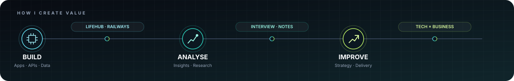

<!-- Personal profile README — Aman Jain | motion-led portfolio -->

  

  
  
  

---

## Technology, data & business — connected

I'm a **Full Stack Developer and Consultant & Data Analyst** with **6+ years of experience** across software development, data analysis, business analysis, and management consulting.

I enjoy moving between understanding a problem, exploring the evidence, and building a useful solution. My approach combines **engineering thinking, analytical rigour, and practical business outcomes**.

- **Current role:** Senior Associate — Consultant & Data Analyst at **Nangia & Co. LLP**.
- **Consulting:** Supporting Railway Board initiatives through TT&BRU, including business research, commercial studies, stakeholder consultations, field surveys, reports, and digital transformation.
- **Development:** Responsive web applications, APIs, database-backed platforms, and productivity tools.
- 📍 **Location:** New Delhi, India.
- 💼 **Portfolio:** [Visit my Portfolio](https://amanjaina.github.io/Portfolio/)

  

## What I bring to a project

<table>
  <tr>
    <td width="33%" valign="top">
      <h3>01 / Build</h3>
      Create responsive, maintainable digital products with practical interfaces, integrations, and reliable data flows.
        FULL STACK · APIS · DATABASES
    </td>
    <td width="33%" valign="top">
      <h3>02 / Analyse</h3>
      Turn information and research into structured findings, clear reports, and decision-ready insights.
        DATA · BUSINESS ANALYSIS · RESEARCH
    </td>
    <td width="33%" valign="top">
      <h3>03 / Improve</h3>
      Connect user and operational needs with business opportunities and implementable recommendations.
        CONSULTING · STRATEGY · DIGITAL CHANGE
    </td>
  </tr>
</table>

## Selected projects

<table>
  <tr>
    <td width="50%" valign="top">
      <h3>🏡 <a href="https://github.com/AmanJainA/LifeHub">LifeHub</a></h3>
      PRODUCTIVITY · WEB APP
      
A private personal workspace for signing in and keeping useful notes in one place. Capture information as it comes up, return to saved notes later, and keep your personal reference material organised instead of scattered across tabs and documents.

      
    </td>
    <td width="50%" valign="top">
      <h3>🚆 <a href="https://github.com/AmanJainA/Railways">Railways</a></h3>
      RAILWAY · PORTAL
      
A central place to browse railway-related information and work with organised operational records. The portal is intended to make information easier to find, review, and maintain, helping users spend less time switching between disconnected records.

      
    </td>
  </tr>
  <tr>
    <td width="50%" valign="top">
      <h3>🧠 <a href="https://github.com/AmanJainA/Interview">Interview</a></h3>
      LEARNING · ASSESSMENT
      
A focused practice space for answering multiple-choice interview questions under timed conditions. Use it to simulate an assessment, test your knowledge, submit an attempt, and review results to identify topics that may need more preparation.

      
    </td>
    <td width="50%" valign="top">
      <h3>📝 <a href="https://github.com/AmanJainA/Notes">Notes</a></h3>
      KNOWLEDGE · ORGANISATION
      
A lightweight place to capture, revisit, and organise written information while staying inside one simple interface. Use it for quick reference notes, study points, reminders, or ideas you want to return to without searching through separate documents.

      
    </td>
  </tr>
</table>

  <a href="https://github.com/AmanJainA?tab=repositories">VIEW ALL REPOSITORIES →</a>

## Tools & capabilities

### Development & data

  
  
  
  
  
  
  
  
  
  

React · JavaScript · HTML · CSS · Bootstrap · jQuery · PHP · Node.js · Flutter · MySQL · Supabase · Microsoft SQL Server · IBM Db2 · Git · GitHub · Postman

### Consulting & Analysis

  
  
  
  
  

Commercial Studies · Operational Research · Process Improvement · Decision Support · Strategic Recommendations

## GitHub at a glance

  <picture>
    <source media="(prefers-color-scheme: dark)" srcset="https://github-readme-stats.vercel.app/api?username=AmanJainA&amp;show_icons=true&amp;hide_border=true&amp;bg_color=0D1117&amp;title_color=67E8F9&amp;icon_color=2DD4BF&amp;text_color=C9D1D9&amp;rank_icon=github" />
    <source media="(prefers-color-scheme: light)" srcset="https://github-readme-stats.vercel.app/api?username=AmanJainA&amp;show_icons=true&amp;hide_border=true&amp;bg_color=FFFFFF&amp;title_color=0969DA&amp;icon_color=0F766E&amp;text_color=24292F&amp;rank_icon=github" />
    
  </picture>
  <picture>
    <source media="(prefers-color-scheme: dark)" srcset="https://github-readme-stats.vercel.app/api/top-langs/?username=AmanJainA&amp;layout=compact&amp;hide_border=true&amp;bg_color=0D1117&amp;title_color=67E8F9&amp;text_color=C9D1D9" />
    <source media="(prefers-color-scheme: light)" srcset="https://github-readme-stats.vercel.app/api/top-langs/?username=AmanJainA&amp;layout=compact&amp;hide_border=true&amp;bg_color=FFFFFF&amp;title_color=0969DA&amp;text_color=24292F" />
    
  </picture>
    
  <picture>
    <source media="(prefers-color-scheme: dark)" srcset="https://streak-stats.demolab.com?user=AmanJainA&amp;hide_border=true&amp;background=0D1117&amp;ring=67E8F9&amp;fire=BEF264&amp;currStreakLabel=67E8F9&amp;sideLabels=C9D1D9&amp;dates=8B949E&amp;currStreakNum=F0F6FC&amp;sideNums=F0F6FC" />
    <source media="(prefers-color-scheme: light)" srcset="https://streak-stats.demolab.com?user=AmanJainA&amp;hide_border=true&amp;background=FFFFFF&amp;ring=0969DA&amp;fire=CF222E&amp;currStreakLabel=0969DA&amp;sideLabels=57606A&amp;dates=6E7781&amp;currStreakNum=24292F&amp;sideNums=24292F" />
    
  </picture>

### Contribution snake

  <picture>
    <source media="(prefers-color-scheme: dark)" srcset="https://raw.githubusercontent.com/AmanJainA/AmanJainA/output/github-contribution-grid-snake-dark.svg" />
    <source media="(prefers-color-scheme: light)" srcset="https://raw.githubusercontent.com/AmanJainA/AmanJainA/output/github-contribution-grid-snake.svg" />
    
  </picture>

---

### Have a problem worth solving?

**Let's connect technology, data, and business to make something useful.**

  

Built with curiosity · Improved through iteration · Always learning

