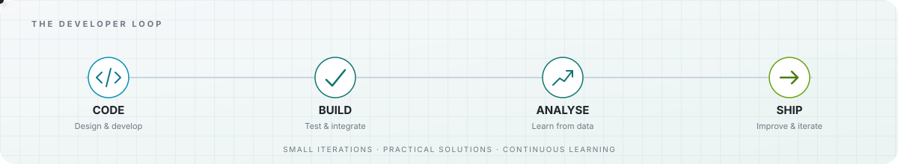

<!-- Personal profile README — Aman Jain | motion-led portfolio -->

 

  
  

---

## Technology, data & business — connected

I'm a **Full Stack Developer and Consultant & Data Analyst** with **6+ years of experience** across software development, data analysis, business analysis, and management consulting.

I enjoy moving between understanding a problem, exploring the evidence, and building a useful solution. My approach combines **engineering thinking, analytical rigour, and practical business outcomes**.

- **Current role:** Senior Associate — Consultant & Data Analyst at **Nangia & Co. LLP**.
- **Consulting:** Supporting Railway Board initiatives through TT&BRU, including business research, commercial studies, stakeholder consultations, field surveys, reports, and digital transformation.
- **Development:** Responsive web applications, APIs, database-backed platforms, and productivity tools.
- 📍 **Location:** New Delhi, India.
- 💼 **Portfolio:** [Visit my Portfolio](https://amanjaina.github.io/Portfolio/)

  

## What I bring to a project

<table>
  <tr>
    <td width="33%" valign="top">
      <h3>01 / Build</h3>
      Create responsive, maintainable digital products with practical interfaces, integrations, and reliable data flows.
        FULL STACK · APIS · DATABASES
    </td>
    <td width="33%" valign="top">
      <h3>02 / Analyse</h3>
      Turn information and research into structured findings, clear reports, and decision-ready insights.
        DATA · BUSINESS ANALYSIS · RESEARCH
    </td>
    <td width="33%" valign="top">
      <h3>03 / Improve</h3>
      Connect user and operational needs with business opportunities and implementable recommendations.
        CONSULTING · STRATEGY · DIGITAL CHANGE
    </td>
  </tr>
</table>

## Selected projects

<table>
  <tr>
    <td width="50%" valign="top">
      <h3>🏡 <a href="https://github.com/AmanJainA/LifeHub">LifeHub</a></h3>
      PRODUCTIVITY · WEB APP
      
A personal dashboard built around everyday productivity, with private sign-in and a notes workflow for capturing, saving, and revisiting information. Supabase supports authentication and data storage, so personal content stays connected to the signed-in user.

      
    </td>
    <td width="50%" valign="top">
      <h3>🚆 <a href="https://github.com/AmanJainA/Railways">Railways</a></h3>
      RAILWAY · PORTAL
      
A railway operations portal built with React and PHP/MySQL, designed to present structured railway information through a web interface backed by a database. It provides a foundation for centralised records and practical, data-driven workflows.

      
    </td>
  </tr>
  <tr>
    <td width="50%" valign="top">
      <h3>🧠 <a href="https://github.com/AmanJainA/Interview">Interview</a></h3>
      LEARNING · ASSESSMENT
      
An interview-practice platform where users can work through multiple-choice questions with timed assessments. Its Supabase-backed workflow supports question management, submitted results, and activity tracking—useful for practice as well as reviewing performance.

      
    </td>
    <td width="50%" valign="top">
      <h3>📝 <a href="https://github.com/AmanJainA/Notes">Notes</a></h3>
      KNOWLEDGE · ORGANISATION
      
A browser-based notes app focused on quick capture and organised access to written information. Its React routing keeps navigation within the app, making it a lightweight place to store and return to useful notes.

      
    </td>
  </tr>
</table>

  <a href="https://github.com/AmanJainA?tab=repositories">VIEW ALL REPOSITORIES →</a>

## Tools & capabilities

  <strong>Frontend</strong>&nbsp;    &nbsp;·&nbsp;
  <strong>Backend & APIs</strong>&nbsp;   &nbsp;·&nbsp;
  <strong>Mobile</strong>&nbsp;  &nbsp;·&nbsp;
  <strong>Databases</strong>&nbsp;   &nbsp;·&nbsp;
  <strong>Tools</strong>&nbsp;   &nbsp;·&nbsp;
  <strong>Consulting & Analysis</strong>&nbsp; 📊 📈 🔎 🤝 📝 ⚙️

React · JavaScript · HTML/CSS · PHP · Node.js · Flutter · MySQL · Supabase · SQL Server · IBM Db2 · Git/GitHub · Postman · Data & Business Analysis · Market Research · Stakeholder Engagement · Reporting · Digital Transformation

## GitHub at a glance

  <picture>
    <source media="(prefers-color-scheme: dark)" srcset="https://github-readme-stats.vercel.app/api?username=AmanJainA&amp;show_icons=true&amp;hide_border=true&amp;bg_color=0D1117&amp;title_color=67E8F9&amp;icon_color=2DD4BF&amp;text_color=C9D1D9&amp;rank_icon=github" />
    <source media="(prefers-color-scheme: light)" srcset="https://github-readme-stats.vercel.app/api?username=AmanJainA&amp;show_icons=true&amp;hide_border=true&amp;bg_color=FFFFFF&amp;title_color=0969DA&amp;icon_color=0F766E&amp;text_color=24292F&amp;rank_icon=github" />
    
  </picture>
  <picture>
    <source media="(prefers-color-scheme: dark)" srcset="https://github-readme-stats.vercel.app/api/top-langs/?username=AmanJainA&amp;layout=compact&amp;hide_border=true&amp;bg_color=0D1117&amp;title_color=67E8F9&amp;text_color=C9D1D9" />
    <source media="(prefers-color-scheme: light)" srcset="https://github-readme-stats.vercel.app/api/top-langs/?username=AmanJainA&amp;layout=compact&amp;hide_border=true&amp;bg_color=FFFFFF&amp;title_color=0969DA&amp;text_color=24292F" />
    
  </picture>
    
  <picture>
    <source media="(prefers-color-scheme: dark)" srcset="https://streak-stats.demolab.com?user=AmanJainA&amp;hide_border=true&amp;background=0D1117&amp;ring=67E8F9&amp;fire=BEF264&amp;currStreakLabel=67E8F9&amp;sideLabels=C9D1D9&amp;dates=8B949E&amp;currStreakNum=F0F6FC&amp;sideNums=F0F6FC" />
    <source media="(prefers-color-scheme: light)" srcset="https://streak-stats.demolab.com?user=AmanJainA&amp;hide_border=true&amp;background=FFFFFF&amp;ring=0969DA&amp;fire=CF222E&amp;currStreakLabel=0969DA&amp;sideLabels=57606A&amp;dates=6E7781&amp;currStreakNum=24292F&amp;sideNums=24292F" />
    
  </picture>

### Developer activity · in motion

  <a href="https://github.com/AmanJainA?tab=overview&from=2026-01-01&to=2026-12-31">
    <picture>
      <source media="(prefers-color-scheme: dark)" srcset="./assets/activity-motion.svg" />
      <source media="(prefers-color-scheme: light)" srcset="./assets/activity-motion-light.svg" />
      
    </picture>
  </a>
   

> The external activity-graph image service is currently unreliable, so this section now uses a self-hosted animated SVG instead of showing a broken image. The live contribution history remains available on GitHub.

### Contribution snake

  <picture>
    <source media="(prefers-color-scheme: dark)" srcset="https://raw.githubusercontent.com/AmanJainA/AmanJainA/output/github-contribution-grid-snake-dark.svg" />
    <source media="(prefers-color-scheme: light)" srcset="https://raw.githubusercontent.com/AmanJainA/AmanJainA/output/github-contribution-grid-snake.svg" />
    
  </picture>

---

### Have a problem worth solving?

**Let's connect technology, data, and business to make something useful.**

  

Built with curiosity · Improved through iteration · Always learning

